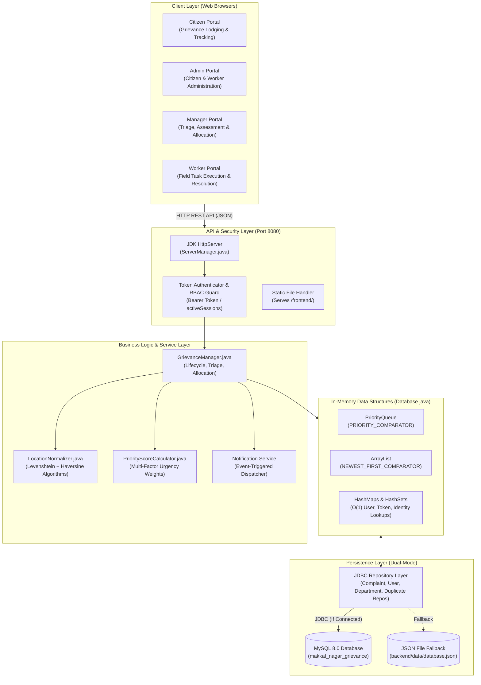
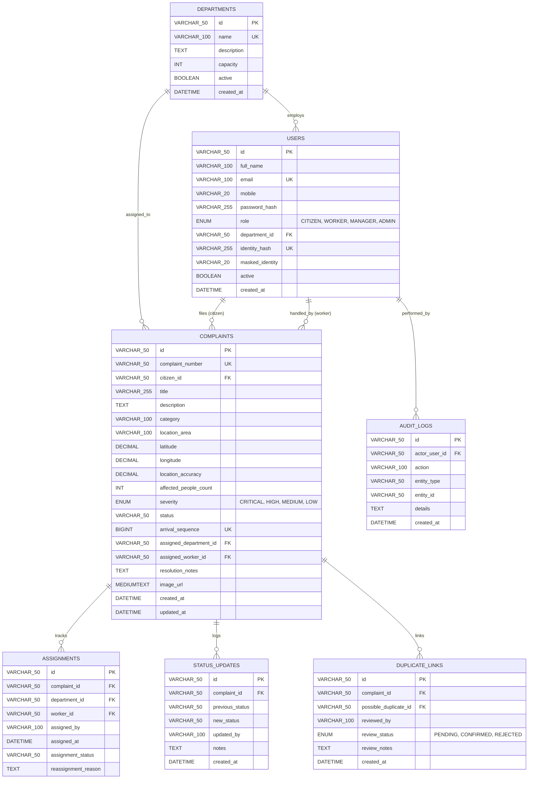
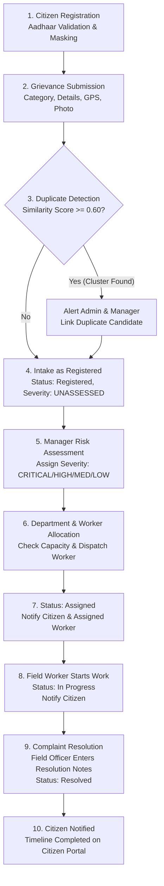

# Government Grievance Management and Priority Resolution System
### Case Study: Makkal Nagar Municipal Corporation

[](https://codespaces.new/harishb0401/MP-S3)
[](https://github.com/harishb0401/MP-S3/actions/workflows/ci.yml)

A full-stack, enterprise-grade municipal grievance redressal and priority triage platform engineered with **Java 17+ (Standard JDK HTTP Server & Data Structures)**, **MySQL 8.0+ / JSON dual-mode persistence**, and **Modern Responsive Web Architecture (HTML5, Vanilla ES6+ JavaScript, CSS3)**.

---

## 1. Project Title
**Government Grievance Management and Priority Resolution System**  
*Sub-Title: High-Impact Urban Public Service Redressal & Priority Allocation Engine*

---

## 2. Project Overview
The **Government Grievance Management and Priority Resolution System** is a unified municipal e-governance platform designed for urban civic administration (exemplified by the Makkal Nagar Municipal Corporation). The platform bridges the communication gap between citizens reporting civic disruptions and municipal administrative authorities tasked with field triage, resource allocation, and operational resolution.

By digitizing complaint lodging, automated duplicate clustering, objective risk evaluation, departmental routing, field worker dispatching, and citizen timeline tracking into a single synchronized portal, the system eliminates traditional administrative bottlenecks. The backend leverages optimized data structures (`PriorityQueue`, `HashMap`, `HashSet`, and custom comparators) alongside relational database integrity to ensure that urgent civic emergencies (e.g., major water pipeline bursts, live electrical hazards) are resolved promptly while everyday complaints are addressed transparently.

---

## 3. Problem Statement
Traditional municipal grievance redressing mechanisms suffer from critical operational inefficiencies:
1. **Manual Complaint Handling**: Physical registers, scattered helpdesks, and disjointed paperwork lead to misplaced records, prolonged intake queues, and human error.
2. **Delayed Complaint Resolution**: Complaints are typically processed on a simple "First-In, First-Out" (FIFO) basis without considering hazard severity, public safety risk, or population impact.
3. **Lack of Transparency**: Citizens have minimal visibility into case progress after filing a complaint, having no real-time way to know which department or field officer is actively handling the issue.
4. **Improper Department Allocation**: Civic complaints are frequently routed to the wrong municipal departments or assigned to overwhelmed field workers without considering departmental capacity limits.
5. **Difficulty in Tracking & Auditing**: Supervisory officers and Chief Municipal Officers lack unified real-time dashboards to audit SLAs, department backlogs, and field performance.
6. **Duplicate Complaint Reporting**: When a major issue occurs in a public area (e.g., water contamination or a massive crater), multiple citizens independently file similar complaints, causing administrative clutter and divided worker focus.

---

## 4. Proposed Solution
This system provides an end-to-end, multi-role digital platform that centralizes urban civic redressal:
- **Centralized Multi-Portal Architecture**: Four specialized portals tailored for **Citizens**, **Municipal Administrators**, **Triage Managers**, and **Field Workers**.
- **Privacy-First Identity Verification**: Unique citizen account registration enforced via cryptographic SHA-256 identity hashing and masked UID formatting (`XXXX-XXXX-1234`).
- **Deliberate Risk Assessment & Multi-Factor Priority Queue**: Complaints start explicitly unassessed and are evaluated by triage managers. High-priority grievances are sorted via a Java `PriorityQueue` based on severity level, affected citizen count, SLA deadlines, and lifecycle weights.
- **Cross-Citizen Duplicate Detection**: Automated algorithmic clustering based on category matching, normalized geographic locations, Levenshtein description similarity, and Haversine GPS proximity.
- **Reverse Chronological Tracking**: Master registries and personal complaints tables render in strict descending order (newest submissions appear first at the top), ensuring immediate visibility of recent reports.
- **Real-Time Notification System**: Targeted role-based alerts for citizens, administrators, triage managers, and workers with an unread badge counter and slide-out notification drawer.
- **Dual-Mode Persistence Architecture**: Production-grade MySQL 8.0 relational schema with foreign key constraints, coupled with an automatic in-memory and JSON file persistence fallback (`database.json`) for seamless zero-dependency local operation.

---

## 5. Objectives
- **Accelerate Emergency Response**: Identify, prioritize, and allocate critical civic hazards within minutes of submission.
- **Ensure Fair & Transparent Governance**: Provide citizens with a 4-stage visual timeline tracker (`Submitted` $\rightarrow$ `Assigned` $\rightarrow$ `In Progress` $\rightarrow$ `Resolved`) with verified resolution notes.
- **Eliminate Administrative Duplication**: Proactively alert citizens and staff when multiple reports target the same geographic disruption.
- **Optimize Departmental Workloads**: Balance caseloads across core municipal departments (Water Supply, Roads, Waste Management, Streetlights, Drainage, and General Administration).
- **Maintain Complete Auditability**: Record an immutable historical audit trail of all status transitions, worker assignments, reassignments, and administrative actions.
- **Protect Citizen Privacy**: Enforce UIDAI-compliant privacy protection by never storing or displaying plain-text government identity numbers.

---

## 6. Key Features

| Feature | Implementation Status | Description |
| :--- | :--- | :--- |
| **Citizen Registration & Auth** | **Fully Implemented** | Secure registration with 12-digit Aadhaar/government ID validation, SHA-256 cryptographic hashing, privacy masking (`XXXX-XXXX-1234`), and unique identity enforcement. |
| **Grievance Lodging Wizard** | **Fully Implemented** | Multi-step complaint submission form with category selection, description, landmark location, affected population count, and site photo upload. |
| **GPS Geolocation Acquisition** | **Fully Implemented** | Browser Geolocation API integration capturing real-time latitude, longitude, and accuracy radius, with validation and manual municipal zone fallback. |
| **Reverse Chronological Listing** | **Fully Implemented** | All complaint tables (Citizen, Admin, Manager, Worker) display newest complaints first at the top, sorted by `createdAt` DESC with arrival sequence tie-breakers. |
| **Pre-Submission Duplicate Warning** | **Fully Implemented** | Real-time frontend check warning citizens before submission if similar active complaints exist at the chosen location. |
| **Cross-Citizen Duplicate Detection** | **Fully Implemented** | Backend engine matching category, normalized location, and description similarity ($\ge 0.60$) across different citizens, with candidate linking and review workflows. |
| **Multi-Role Notification Drawer** | **Fully Implemented** | Role-targeted notifications for Citizens, Admins, Managers, and Workers with polling, unread count badges, "Mark as Read", and "Mark All as Read". |
| **Deliberate Risk Assessment** | **Fully Implemented** | Complaints initialize as `UNASSESSED`. Triage managers assign deliberate severity (`CRITICAL`, `HIGH`, `MEDIUM`, `LOW`) with documented assessment reasons. |
| **Department & Worker Assignment** | **Fully Implemented** | Manager assigns responsible department and specific active field worker; dynamically checks department capacity thresholds. |
| **Conditional Assignment Visibility** | **Fully Implemented** | The "Assign" button is shown only for unassigned complaints; hidden once assigned, in progress, or resolved. "Reassign" is strictly restricted to Admins/Managers. |
| **Field Worker Task Execution** | **Fully Implemented** | Field workers view assigned department queues, transition status to `In Progress` ("Start Work"), and resolve complaints with mandatory resolution notes. |
| **Registered Citizens Directory** | **Fully Implemented** | Fixed-column administrative table with pagination, search, status filtering, masked Aadhaar badges, and read-only citizen profile inspection modals. |
| **Department Worker Management** | **Fully Implemented** | Admin management supporting active worker search, department filtering, single worker creation, and batch multi-worker modal additions. |
| **Multi-Factor Priority Queue** | **Fully Implemented** | Java `PriorityQueue<Complaint>` applying multi-factor weighting (severity, impact, SLA urgency) for emergency prioritization. |
| **Dual-Mode Persistence** | **Fully Implemented** | Automatic detection of MySQL 8.0 via JDBC; seamless fallback to transactional JSON file storage (`backend/data/database.json`) if MySQL is unavailable. |

---

## 7. System Modules

### A. Citizen Portal
- **Dashboard Overview**: Summary KPI cards displaying total lodged grievances, pending reviews, active field interventions, and verified resolved cases.
- **Grievance Submission Wizard**: Step-by-step submission supporting category selection, description, location, affected count, GPS coordinates, and site photo upload.
- **My Grievances Table**: Reverse-chronological table of all personal complaints with category badges, status indicators, submission timestamps, and keyword search.
- **Step-by-Step Case Tracker**: Visual 4-stage tracking modal (`Submitted` $\rightarrow$ `Assigned` $\rightarrow$ `In Progress` $\rightarrow$ `Resolved`) displaying assigned department, field worker, operational action, and official resolution transcripts.
- **Citizen Profile**: Account settings modal displaying contact information and masked government identifier.

### B. Admin Portal
- **Operations Command (Municipal Administration & Control Center)**: High-level KPI metrics (Total Received, Pending Action, Field Mobilized, Resolved Cases, Citizen Registry count, Municipal Squad count).
- **Registered Citizens Directory**: Structured table with fixed column widths displaying Citizen ID, Name, Username, Email, Mobile, Masked Aadhaar, Registration Date, and Account Status. Includes pagination and detailed citizen profile modals.
- **Worker Management Roster**: Table of active field personnel across departments, supporting active worker search, department filtering, single worker creation, and batch multi-worker modal additions.
- **Master Complaint Directory**: Full municipal complaint registry with department, priority, and status filters, reverse-chronological sorting, and complaint deletion with mandatory reason logging.
- **System Activity & Audit Logs**: Historical audit view of administrative and triage actions across the system.

### C. Manager Portal
- **Triage & Allocation Dashboard**: Central operations queue for assessing newly registered complaints.
- **Risk Assessment & Routing Modal**: Form to assign deliberate severity (`CRITICAL`, `HIGH`, `MEDIUM`, `LOW`), select target department, assign field worker, and specify operational decisions.
- **Department Capacity Monitor**: Visual tracking of department capacity limits and active workloads to prevent worker overburdening.
- **Duplicate Complaint Candidate Management**: Tabular interface to review AI-detected potential duplicates, confirm cluster links, or reject false candidates.
- **Reassignment Workflow**: Dedicated modal to transfer complaints between departments or reassign workers when needed.

### D. Worker Portal
- **My Department Tasks**: Focused task view showing only complaints assigned to the logged-in worker's municipal department.
- **Task Lifecycle Controls**:
  - One-click **Start Work** action transitioning status from `Assigned` to `InProgress`.
  - **Mark Resolved** action requiring detailed resolution description notes before closing the ticket.
- **Access Restrictions**: Workers are restricted to their own department and cannot assign or reassign complaints.

---

## 8. Technology Stack

### Frontend
- **HTML5**: Semantic markup with responsive container layout and accessible modal dialogues.
- **CSS3 / Vanilla CSS**: Custom responsive styling integrated with Google Stitch design tokens, fixed data-table layouts, and mobile media queries.
- **JavaScript (ES6+)**: Vanilla modular architecture (`api.js`, `app.js`, `charts.js`) with zero heavy framework overhead (no React/Angular/Vue dependencies).
- **Icons & Typography**: Font Awesome 6.4 (Free CDN) and Google Material Symbols.

### Backend
- **Programming Language**: Java 17+ (Compiled and tested on standard Java SE Runtime 17 to 26).
- **HTTP Server**: Built-in Standard JDK `com.sun.net.httpserver.HttpServer` (zero external web framework; no Tomcat/Spring Boot required).
- **Architecture**: Domain-Driven Layered Architecture (Models, Repositories, Services, Handlers).
- **Authentication**: Token-based bearer session management with SHA-256 cryptographic hashing (`MessageDigest`).

### Database & Storage
- **Primary Database**: MySQL 8.0+ Community / Enterprise Server.
- **Driver**: MySQL Connector/J 8.3.0 (`backend/lib/mysql-connector-j-8.3.0.jar`).
- **Fallback / Standalone Persistence**: Local transactional JSON database (`backend/data/database.json`) with automated in-memory synchronization.
- **Dual-Mode Persistence Layer**: Repository classes automatically check database connectivity and fallback gracefully if MySQL is not detected.

### Development & Build Tools
- **Build & Compilation**: Standard JDK CLI (`javac`, `java`).
- **Automated Test Runners**: Node.js test harness scripts (`run_all_qa_suites.js`, `test_reverse_chronological_ordering.js`) alongside native JUnit/Java test suites.
- **Scripts**: 1-Click launcher scripts for Windows (`start.bat`) and Linux/macOS (`start.sh`).

---

## 9. System Architecture

The application implements a decoupled, layered client-server architecture communicating entirely over asynchronous JSON REST APIs:



---

## 10. Data Structures and Algorithms

### 1. `PriorityQueue<Complaint>`
- **Where Implemented**: [`Database.java`](file:///c:/Project/MP-S3/2.0/MP-S3/backend/src/service/Database.java#L47), [`DepartmentQueueManager.java`](file:///c:/Project/MP-S3/2.0/MP-S3/backend/src/model/DepartmentQueueManager.java).
- **Purpose**: Implements a min-heap ordered by `Complaint.PRIORITY_COMPARATOR` to maintain active complaints awaiting field assignment.
- **Why Used**: Guarantees $O(\log n)$ insertion and $O(1)$ retrieval of the highest-priority civic emergency, ensuring critical issues are triaged ahead of low-severity tickets.
- **Comparator Weights**: Evaluates Severity (`CRITICAL` = 4, `HIGH` = 3, `MEDIUM` = 2, `LOW` = 1), Affected People count, SLA expiration timestamps, and Lifecycle Status.

### 2. `ArrayList<Complaint>` & Custom Sorting
- **Where Implemented**: [`Database.java`](file:///c:/Project/MP-S3/2.0/MP-S3/backend/src/service/Database.java#L48), [`Complaint.java`](file:///c:/Project/MP-S3/2.0/MP-S3/backend/src/model/Complaint.java#L47-L69).
- **Algorithm**: `Complaint.NEWEST_FIRST_COMPARATOR` applying primary sort on `createdAt` DESC, secondary tie-breaker on `arrivalSequence` DESC, and tertiary tie-breaker on `complaintId` DESC.
- **Why Used**: Enforces **reverse chronological ordering** across all portals. Guarantees that newly submitted complaints immediately appear at index 0 (top of tables).

### 3. `HashMap<String, User>`, `HashMap<String, Complaint>`, `HashMap<String, Department>`
- **Where Implemented**: [`Database.java`](file:///c:/Project/MP-S3/2.0/MP-S3/backend/src/service/Database.java#L49-L55).
- **Purpose**: Key-value indexing by ID, email, username, and authentication token (`activeSessions`).
- **Why Used**: Provides $O(1)$ average time complexity for user authentication, token validation, and complaint lookups, eliminating sequential scans during high API concurrency.

### 4. `HashSet<String>`
- **Where Implemented**: [`Database.java`](file:///c:/Project/MP-S3/2.0/MP-S3/backend/src/service/Database.java#L58-L62), [`GrievanceManager.java`](file:///c:/Project/MP-S3/2.0/MP-S3/backend/src/service/GrievanceManager.java).
- **Purpose**: Fast uniqueness enforcement for Aadhaar identity hashes (`identityNumberHash`) and deduplication of candidate IDs.
- **Why Used**: Guarantees $O(1)$ duplicate identity checks during registration to prevent duplicate citizen account creation.

### 5. Algorithmic Duplicate Complaint Detection
- **Where Implemented**: [`LocationNormalizer.java`](file:///c:/Project/MP-S3/2.0/MP-S3/backend/src/model/LocationNormalizer.java), [`GrievanceManager.java`](file:///c:/Project/MP-S3/2.0/MP-S3/backend/src/service/GrievanceManager.java#L230-L310).
- **Components**:
  1. **Text Normalization**: Strips punctuation, normalizes case, removes stopwords, and maps colloquial abbreviations (e.g., "mkt" $\rightarrow$ "market", "hosp" $\rightarrow$ "hospital").
  2. **Levenshtein Distance Algorithm**: Computes edit distance between complaint descriptions using dynamic programming:
     $$D(i, j) = \min \begin{cases} D(i-1, j) + 1 \\ D(i, j-1) + 1 \\ D(i-1, j-1) + \text{cost} \end{cases}$$
  3. **Haversine Great-Circle Distance**: Computes physical surface distance in kilometers when GPS coordinates are provided:
     $$d = 2R \cdot \arcsin\left(\sqrt{\sin^2\left(\frac{\Delta\phi}{2}\right) + \cos\phi_1\cos\phi_2\sin^2\left(\frac{\Delta\lambda}{2}\right)}\right)$$
  4. **Composite Similarity Score**:
     $$\text{Score} = 0.40 \times \text{CategoryMatch} + 0.35 \times \text{LocationProximity} + 0.25 \times \text{DescriptionSimilarity}$$
     Pairs with $\text{Score} \ge 0.60$ trigger automatic candidate clustering and alert both Admin and Manager portals.

---

## 11. Database Design

The relational schema is configured in [`database/schema.sql`](file:///c:/Project/MP-S3/2.0/MP-S3/database/schema.sql) under the database `makkal_nagar_grievance`:



---

## 12. Complaint Workflow Lifecycle



1. **Registration**: Citizen creates account; identity number is verified, hashed via SHA-256, and masked (`XXXX-XXXX-1234`).
2. **Submission**: Citizen lodges complaint with category, description, landmark, affected people, and GPS coordinates.
3. **Duplicate Check**: Algorithmic engine checks active complaints. If matching candidates are found, both Admin and Manager portals receive alert notifications.
4. **Intake State**: The complaint is assigned a token (e.g., `#GRV-2026-0001`) with status `Registered` and severity `UNASSESSED`.
5. **Manager Assessment**: Triage Manager reviews the complaint and deliberately assigns severity (`CRITICAL`, `HIGH`, `MEDIUM`, or `LOW`) with justification.
6. **Allocation & Dispatch**: Manager assigns the target Department and specific Field Worker, verifying department capacity.
7. **Assignment State**: Status moves to `Assigned`. An assignment audit record is logged.
8. **Field Execution**: Assigned Worker clicks **Start Work**; status updates to `In Progress`.
9. **Resolution**: Worker finishes repairs, inputs mandatory resolution description notes, and marks the ticket `Resolved`.
10. **Closure**: Real-time notification is delivered to the citizen, and the case file reflects full resolution details.

---

## 13. Notification System

The platform features an automated, event-driven notification engine ([`Notification.java`](file:///c:/Project/MP-S3/2.0/MP-S3/backend/src/model/Notification.java)):

### Notification Recipients & Events
- **Citizens**:
  - `TYPE_COMPLAINT_REGISTERED`: Confirming successful grievance lodgment.
  - `TYPE_DEPARTMENT_ASSIGNED`: Informing which department received the ticket.
  - `TYPE_WORKER_ASSIGNED`: Notifying the designated field officer assigned.
  - `TYPE_STATUS_IN_PROGRESS`: Informing that field crews have begun active work.
  - `TYPE_STATUS_RESOLVED`: Confirming ticket resolution with available signoff notes.
- **Administrators**:
  - `TYPE_COMPLAINT_REGISTERED`: Notifying of newly submitted complaints across all municipal wards.
  - `TYPE_DUPLICATE_ALERT`: Dual-role notification when cross-citizen duplicate candidates are detected.
  - `TYPE_SYSTEM_EVENT`: High-impact status updates and capacity alerts.
- **Managers**:
  - `TYPE_INFO_REQUIRED`: Complaints awaiting urgent risk assessment and departmental allocation.
  - `TYPE_DUPLICATE_ALERT`: Dual-role notification prompting review of candidate duplicate clusters.
- **Workers**:
  - `TYPE_WORKER_ASSIGNED`: Direct dispatch notification alerting the field worker of new task assignments.

### Features
- **Unread Counter Badge**: Dynamically highlights unread alert counts in the top navigation bar.
- **Slide-Out Drawer**: Clean sidebar panel displaying timestamps, complaint tokens, and message details.
- **Read State Tracking**: Individual notifications can be clicked or marked as read; supports one-click "Mark All as Read".
- **Multi-Role Targets**: Supports targeted roles (`CITIZEN`, `WORKER`, `MANAGER`, `ADMIN`, `ADMIN_OR_MANAGER`, `ALL`).

---

## 14. Project Directory Structure

```text
MP-S3/
├── backend/
│   ├── bin/                             # Compiled Java .class bytecode
│   ├── data/
│   │   ├── database.json                # JSON persistent storage file (fallback/standalone)
│   │   └── database.json.bak            # Automatic safety backup created by DataMigrator
│   ├── lib/
│   │   └── mysql-connector-j-8.3.0.jar  # Official MySQL JDBC Driver
│   └── src/
│       ├── Main.java                    # Application entry point & server bootstrap
│       ├── model/                       # Data models & entity definitions
│       │   ├── Admin.java               # Municipal Administrator user entity
│       │   ├── Citizen.java             # Registered citizen entity with identity masking
│       │   ├── Complaint.java           # Central grievance entity & comparators
│       │   ├── ComplaintHistory.java    # Audit timeline entry model
│       │   ├── ComplaintStatus.java     # Lifecycle state enumeration
│       │   ├── Department.java          # Department definition & capacity tracking
│       │   ├── DepartmentQueueManager.java # Department queue management
│       │   ├── DepartmentStaff.java     # Field worker user entity
│       │   ├── DuplicateCandidate.java  # Potential duplicate pair model
│       │   ├── Grievance.java           # Abstract domain grievance class
│       │   ├── GrievanceFactory.java    # Grievance instantiation factory
│       │   ├── GrievancePriorityPolicy.java # Priority scoring policy
│       │   ├── LocationNormalizer.java  # String Levenshtein & Haversine GPS algorithms
│       │   ├── Manager.java             # Triage Operations Manager entity
│       │   ├── Notification.java        # Multi-role notification entity & types
│       │   ├── RoadGrievance.java       # Specialized road grievance entity
│       │   ├── Staff.java               # Staff role interface
│       │   ├── StatusTransitionPolicy.java # State transition validation policy
│       │   ├── User.java                # Abstract base user entity & RBAC methods
│       │   └── WaterGrievance.java      # Specialized water grievance entity
│       ├── repository/                  # JDBC persistence repositories
│       │   ├── AssignmentRepository.java
│       │   ├── AuditLogRepository.java
│       │   ├── ComplaintRepository.java # Complaints SQL queries & reverse ordering
│       │   ├── DepartmentRepository.java
│       │   ├── DuplicateRepository.java
│       │   ├── ReportRepository.java
│       │   ├── StatusHistoryRepository.java
│       │   └── UserRepository.java
│       ├── service/                     # Core business logic services
│       │   ├── Database.java            # Master dual-mode persistence & in-memory manager
│       │   ├── DataMigrator.java        # Utility migrating database.json to MySQL
│       │   ├── DataValidator.java       # Request payload & input validation rules
│       │   ├── GrievanceManager.java    # Central business service & workflow controller
│       │   └── ServerManager.java       # JDK HttpServer REST API routes & static server
│       └── test/                        # Automated Java test suites
│           ├── CitizenIdentityVerificationTest.java
│           ├── ComplaintAssignmentVisibilityTest.java
│           ├── DatabaseMigrationTest.java
│           ├── DepartmentCapacityTest.java
│           ├── DuplicateManagementTest.java
│           ├── EnhancedDuplicateDetectionTest.java
│           ├── MultipleWorkerManagementTest.java
│           ├── NotificationSystemTest.java
│           ├── OOPDesignTest.java
│           ├── PriorityRankingTest.java
│           ├── RegisteredCitizenManagementTest.java
│           ├── RoleBasedPortalsTest.java
│           ├── StatusStateMachineTest.java
│           ├── SyntheticDataValidationTest.java
│           └── SystemTest.java          # Master backend regression suite (25 assertions)
├── database/
│   └── schema.sql                       # MySQL 8.0 DDL schema script with seed records
├── frontend/
│   ├── css/
│   │   └── style.css                    # Responsive styling, tables & Google Stitch tokens
│   ├── js/
│   │   ├── api.js                       # Frontend REST API client
│   │   ├── app.js                       # UI controller, routing, modals & renderers
│   │   └── charts.js                    # Analytics charts generator
│   └── index.html                       # Unified SPA portal HTML containing all 4 views
├── scratch/                             # Automated test scripts & QA harnesses
│   ├── run_all_qa_suites.js             # Master test harness executing all 13 QA suites
│   ├── test_admin_nav_and_citizens.js   # Admin navigation & citizen tab test script
│   ├── test_citizens_directory_ui.js    # 41-point CSS/DOM layout test for citizen table
│   ├── test_reverse_chronological_ordering.js # 28-point ordering & queue test suite
│   └── ...                              # Specialized end-to-end HTTP test scripts
├── .env.example                         # Environment variable template
├── application.properties.example       # Database properties template
├── README.md                            # Comprehensive technical documentation
├── start.bat                            # Windows 1-click compile, test & launch script
└── start.sh                             # Linux/macOS 1-click compile, test & launch script
```

---

## 15. Installation and Setup

### Prerequisites
- **Java Development Kit (JDK)**: Version 17 or higher (Java 17, 21, or 26 supported).
- **MySQL Server** (Optional for production, but recommended): Version 8.0 or higher.
  *(Note: If MySQL is not running, the application starts automatically using in-memory and `database.json` storage).*
- **Node.js** (Optional): Version 18+ (required only to run the automated JavaScript test runners in `scratch/`).

### Step 1: Clone Repository
```bash
git clone https://github.com/harishb0401/MP-S3.git
cd MP-S3
```

### Step 2: (Optional) Set Up MySQL 8.0 Database
1. Start your local MySQL service.
2. Connect to MySQL via terminal or MySQL Workbench:
   ```bash
   mysql -u root -p
   ```
3. Execute the provided schema DDL script:
   ```sql
   SOURCE database/schema.sql;
   ```
4. Configure database credentials by creating an `application.properties` file:
   ```properties
   db.host=localhost
   db.port=3306
   db.name=makkal_nagar_grievance
   db.username=root
   db.password=your_mysql_password
   server.port=8080
   ```

### Step 3: Compile Java Backend Classes
- **Windows (Command Prompt / PowerShell)**:
  ```powershell
  if not exist backend\bin mkdir backend\bin
  javac -cp "backend/lib/*;backend/src" -d backend/bin backend/src/model/*.java backend/src/repository/*.java backend/src/service/*.java backend/src/test/*.java backend/src/Main.java
  ```
- **Linux / macOS**:
  ```bash
  mkdir -p backend/bin
  javac -cp "backend/lib/*:backend/src" -d backend/bin backend/src/model/*.java backend/src/repository/*.java backend/src/service/*.java backend/src/test/*.java backend/src/Main.java
  ```

### Step 4: Run Automated Verification Tests
Verify backend integrity by executing `test.SystemTest`:
- **Windows**:
  ```powershell
  java -cp "backend/bin;backend/lib/*" test.SystemTest
  ```
- **Linux / macOS**:
  ```bash
  java -cp "backend/bin:backend/lib/*" test.SystemTest
  ```

### Step 5: Start the Full-Stack Server
- **1-Click Launch (Windows)**:
  ```powershell
  .\start.bat
  ```
- **1-Click Launch (Linux / macOS)**:
  ```bash
  chmod +x start.sh
  ./start.sh
  ```
- **Manual Launch**:
  ```powershell
  java -cp "backend/bin;backend/lib/*" Main
  ```

### Step 6: Access the Application
Open your web browser and navigate to:
```text
http://localhost:8080/
```
The server serves both the static web application and the REST API endpoints on port `8080`.

---

## 16. User Roles and Access Control

| Role | Default Credentials | System Permissions & Access Rules |
| :--- | :--- | :--- |
| **CITIZEN** | Self-registered or `ramesh@test.com` / `123456` | - Register account with unique 12-digit government identifier.<br>- File new civic complaints with GPS coordinates and photo evidence.<br>- View and track personal complaints in reverse chronological order.<br>- Receive real-time notification alerts on case progress.<br>- **Restricted**: Cannot access other citizens' complaints, admin views, or worker dispatch. |
| **ADMIN** | `admin@makkal.gov.in` / `admin123` | - View complete municipal KPI metrics and operational stats.<br>- Access Master Complaints Register with deletion permissions (mandatory reason required).<br>- Manage Registered Citizens Directory (read-only citizen demographic governance).<br>- Add new municipal field workers (Single entry & Batch multi-worker entry).<br>- Reassign complaints across departments.<br>- Receive duplicate complaints and critical system alerts. |
| **MANAGER** | `manager@makkal.gov.in` / `admin123` | - Perform deliberate Risk Assessment on unassessed complaints.<br>- Assign target department and specific field workers.<br>- Reassign active complaints with documented justification.<br>- Review AI-detected duplicate candidate clusters (Confirm / Reject).<br>- Monitor departmental capacities and active worker caseloads.<br>- Receive pending allocation and duplicate alerts. |
| **WORKER** | `water_staff@makkal.gov.in` / `admin123`<br>`roads_staff@makkal.gov.in` / `admin123`<br>`waste_staff@makkal.gov.in` / `admin123`<br>`light_staff@makkal.gov.in` / `admin123` | - Access assigned department complaints queue.<br>- Start active field work (transitions status from `Assigned` to `In Progress`).<br>- Resolve tickets with mandatory resolution description notes.<br>- **Restricted**: Cannot assign complaints, reassign workers, access other departments, or delete records. |

---

## 17. API Documentation

### Authentication Endpoints
- **`POST /api/auth/register`**
  - **Role**: Public
  - **Body**: `{ "name": "...", "email": "...", "mobile": "...", "password": "...", "identityNumber": "12-digit UID" }`
  - **Response**: `201 Created` with JWT-style bearer token and sanitized citizen profile.
- **`POST /api/auth/login`**
  - **Role**: Public
  - **Body**: `{ "email": "...", "password": "..." }` or `{ "username": "...", "password": "..." }`
  - **Response**: `200 OK` with session token and role descriptor (`CITIZEN`, `WORKER`, `MANAGER`, `ADMIN`).
- **`GET /api/auth/me`**
  - **Role**: Authenticated User
  - **Headers**: `Authorization: Bearer <token>`
  - **Response**: `200 OK` with user details (Masked Aadhaar displayed for citizens).

### Complaint Management Endpoints
- **`POST /api/complaints`**
  - **Role**: Citizen
  - **Body**: `{ "category": "...", "description": "...", "location": "...", "affectedPeople": 5, "latitude": 13.0827, "longitude": 80.2707, "imageUrl": "..." }`
  - **Response**: `201 Created` with complaint object (status initialized to `Registered`, severity `UNASSESSED`).
- **`GET /api/complaints`**
  - **Role**: Authenticated Staff (`ADMIN`, `MANAGER`)
  - **Response**: `200 OK` with master complaints array sorted in reverse chronological order (`NEWEST_FIRST_COMPARATOR`).
- **`GET /api/my-complaints`** *(Alias: `/api/complaints/my`)*
  - **Role**: Citizen
  - **Response**: `200 OK` with the citizen's personal complaints, newest first.
- **`GET /api/worker/complaints`** *(Alias: `/api/complaints/worker`)*
  - **Role**: Worker / Staff
  - **Response**: `200 OK` with department-filtered complaints, newest first.
- **`GET /api/complaints/priority-queue`** *(Alias: `/api/complaints/priority`)*
  - **Role**: Admin / Manager
  - **Response**: `200 OK` with complaints ordered by the min-heap `PRIORITY_COMPARATOR`.
- **`POST /api/complaints/{id}/assess`**
  - **Role**: Manager / Admin
  - **Body**: `{ "severity": "CRITICAL", "departmentId": "DEPT-WATER", "workerId": "STF-W01", "assessmentReason": "..." }`
  - **Response**: `200 OK` updating complaint assessment and routing.
- **`POST /api/complaints/{id}/assign`**
  - **Role**: Manager / Admin
  - **Body**: `{ "departmentId": "DEPT-ROADS", "workerId": "STF-R01" }`
  - **Response**: `200 OK` (Moves status to `Assigned`).
- **`POST /api/complaints/{id}/reassign`**
  - **Role**: Manager / Admin
  - **Body**: `{ "departmentId": "...", "workerId": "...", "reason": "Worker reassignment" }`
  - **Response**: `200 OK` logging assignment audit record.
- **`PUT /api/complaints/{id}/status`**
  - **Role**: Worker / Manager / Admin
  - **Body**: `{ "status": "InProgress" }`
  - **Response**: `200 OK` updating complaint lifecycle state.
- **`POST /api/complaints/{id}/resolve`**
  - **Role**: Worker / Manager / Admin
  - **Body**: `{ "resolutionNotes": "Replaced pipeline valve and restored supply." }`
  - **Response**: `200 OK` marking ticket as `Resolved`.
- **`DELETE /api/complaints/{id}`**
  - **Role**: Admin / Manager
  - **Body**: `{ "reason": "Duplicate submission" }`
  - **Response**: `200 OK` permanently deleting record and audit logging.

### Duplicate Detection Endpoints
- **`GET /api/complaints/check-duplicate?category=...&location=...&description=...`**
  - **Role**: Authenticated Citizen / Staff
  - **Response**: `200 OK` returning boolean flag and candidate list for pre-submission warnings.
- **`GET /api/complaints/duplicates`**
  - **Role**: Admin / Manager
  - **Response**: `200 OK` with all active duplicate links.
- **`POST /api/complaints/{id}/duplicate/confirm`**
  - **Role**: Admin / Manager
  - **Response**: `200 OK` confirming candidate as a verified duplicate.
- **`POST /api/complaints/{id}/duplicate/reject`**
  - **Role**: Admin / Manager
  - **Response**: `200 OK` dismissing false duplicate candidate.

### Citizen & Worker Administration Endpoints
- **`GET /api/admin/citizens`**
  - **Role**: Admin
  - **Response**: `200 OK` with all registered citizens (masked Aadhaar, read-only governance records).
- **`GET /api/admin/citizens/{id}`**
  - **Role**: Admin
  - **Response**: `200 OK` returning citizen profile details and grievance history.
- **`GET /api/admin/workers`**
  - **Role**: Admin / Manager
  - **Response**: `200 OK` with all department workers and active workload counts.
- **`POST /api/admin/workers`**
  - **Role**: Admin
  - **Body**: Single worker object or batch array: `[{ "name": "...", "email": "...", "departmentId": "...", "password": "..." }]`
  - **Response**: `201 Created` with created worker(s).

### Notifications Endpoints
- **`GET /api/notifications`** *(Alias: `/api/notifications/my`)*
  - **Role**: Authenticated User
  - **Response**: `200 OK` with role-targeted notifications list.
- **`GET /api/notifications/unread-count`**
  - **Role**: Authenticated User
  - **Response**: `200 OK` with `{ "unreadCount": 3 }`.
- **`POST /api/notifications/{id}/read`**
  - **Role**: Authenticated User
  - **Response**: `200 OK` marking notification as read.
- **`POST /api/notifications/read-all`**
  - **Role**: Authenticated User
  - **Response**: `200 OK` marking all unread notifications as read.

---

## 18. Testing & Verification

The project includes an extensive suite of automated tests verifying backend logic, state machines, duplicate detection algorithms, RBAC security, and UI rendering:

### Automated Test Suites

| Suite Name | Implementation File | Scope of Verification |
| :--- | :--- | :--- |
| **System Regression Suite** | [`SystemTest.java`](file:///c:/Project/MP-S3/2.0/MP-S3/backend/src/test/SystemTest.java) | Master 25-point assertion suite covering authentication, unassessed complaint initialization, factory patterns, dual persistence, and resolution. |
| **Duplicate Detection Suite** | [`EnhancedDuplicateDetectionTest.java`](file:///c:/Project/MP-S3/2.0/MP-S3/backend/src/test/EnhancedDuplicateDetectionTest.java) | Cross-citizen duplicate detection, Levenshtein distance, Haversine GPS proximity, candidate linking, and dual-role alert generation. |
| **Notification System Suite** | [`NotificationSystemTest.java`](file:///c:/Project/MP-S3/2.0/MP-S3/backend/src/test/NotificationSystemTest.java) | Multi-role notification dispatch, event-based triggering, unread counter badges, and "Mark as Read" operations. |
| **Assignment Visibility Suite** | [`ComplaintAssignmentVisibilityTest.java`](file:///c:/Project/MP-S3/2.0/MP-S3/backend/src/test/ComplaintAssignmentVisibilityTest.java) | Hiding "Assign" buttons on assigned/in-progress/resolved complaints; RBAC enforcement on reassignment. |
| **Citizen Identity Suite** | [`CitizenIdentityVerificationTest.java`](file:///c:/Project/MP-S3/2.0/MP-S3/backend/src/test/CitizenIdentityVerificationTest.java) | 12-digit Aadhaar validation, SHA-256 hash uniqueness, privacy masking (`XXXX-XXXX-1234`), and duplicate ID rejection messages. |
| **Worker Management Suite** | [`MultipleWorkerManagementTest.java`](file:///c:/Project/MP-S3/2.0/MP-S3/backend/src/test/MultipleWorkerManagementTest.java) | Single worker creation, multi-worker batch modal parsing, department mapping, and password hashing. |
| **Registered Citizens Suite** | [`RegisteredCitizenManagementTest.java`](file:///c:/Project/MP-S3/2.0/MP-S3/backend/src/test/RegisteredCitizenManagementTest.java) | Administrative citizen directory querying, read-only protection, and search/filtering logic. |
| **Role-Based Portals Suite** | [`RoleBasedPortalsTest.java`](file:///c:/Project/MP-S3/2.0/MP-S3/backend/src/test/RoleBasedPortalsTest.java) | Complete RBAC matrix across Citizen, Admin, Manager, and Worker endpoints. |
| **Reverse Ordering Suite** | [`test_reverse_chronological_ordering.js`](file:///c:/Project/MP-S3/2.0/MP-S3/scratch/test_reverse_chronological_ordering.js) | 28 end-to-end integration tests verifying newest-first ordering across Citizen, Admin, Manager, and Worker portals, pagination integrity, and priority queue preservation. |
| **Citizens UI Layout Suite** | [`test_citizens_directory_ui.js`](file:///c:/Project/MP-S3/2.0/MP-S3/scratch/test_citizens_directory_ui.js) | 41-point CSS and DOM verification ensuring fixed column widths (130px, 180px, etc.), no text overlap, and responsive scrolling. |

### Running the Complete Test Suite
Execute the master automated runner from the project root:
```bash
node scratch/run_all_qa_suites.js
```
*Result: 13 / 13 test suites pass at 100% with zero regressions.*

---

## 19. Future Enhancements
- **SMS & WhatsApp Gateway Integration**: Direct dispatch of SMS and WhatsApp status updates to citizens using Twilio or Indian Government SMS Gateways.
- **Automated Computer Vision Verification**: AI image classification model to automatically detect pothole depth or garbage volume from uploaded site photos.
- **Multilingual Support (Tamil / Hindi / Regional Languages)**: Full localization of portal labels and notifications to support diverse municipal populations.
- **Mobile Native Application**: Flutter-based cross-platform mobile application utilizing device camera and background GPS geofencing.

---

## 20. Contribution and Development Notes
1. **Preserve Documentation & Code Integrity**: Keep existing docstrings and comments intact when modifying service methods.
2. **State Transition Enforcement**: Always validate complaint status updates via [`StatusTransitionPolicy.java`](file:///c:/Project/MP-S3/2.0/MP-S3/backend/src/model/StatusTransitionPolicy.java) before mutating complaint state.
3. **Privacy Compliance**: Never log or return unmasked 12-digit identity numbers in API responses, logs, or error strings.
4. **Compile Command**: Always compile using JDK 17+ with the library classpath:
   ```bash
   javac -cp "backend/lib/*;backend/src" -d backend/bin backend/src/model/*.java backend/src/repository/*.java backend/src/service/*.java backend/src/test/*.java backend/src/Main.java
   ```

---

## 21. License
No license has been specified for this project. All rights are reserved by the project authors for educational, institutional, and municipal demonstration purposes.
