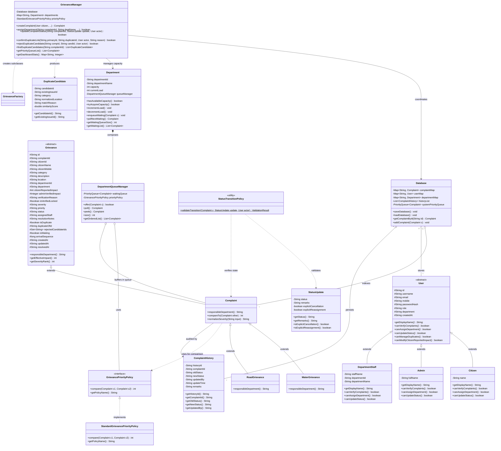

# DELIVERABLE A: UML CLASS DIAGRAM

## 1. Architectural Overview & Object-Oriented Design

The Makkal Nagar Municipal Grievance Management and Priority Resolution System is designed using clean Object-Oriented Programming (OOP) principles in Java. It models municipal domain entities, strict multi-criteria queue prioritization, finite-state lifecycle management, and departmental capacity accounting.

### Key Architectural Concepts
1. **Grievance Abstraction & Polymorphism**:
   - `Grievance`: The abstract base model encapsulating core attributes (identity, citizen reference, category, description, location, reported impact, admin-verified impact, severity, priority, status, duplicate metadata, arrival sequence, and timestamps) and defining the polymorphic operation `responsibleDepartment()`.
   - `Complaint`: Concrete grievance implementation that implements `Comparable<Complaint>` and delegates queue comparison to `GrievancePriorityPolicy`.
   - `WaterGrievance` and `RoadGrievance`: Subclasses inheriting from `Complaint` that override `responsibleDepartment()` to dynamically dispatch to their respective departments (`Water Department` and `Roads Department`).
   - `GrievanceFactory`: Factory demonstrating polymorphic instantiation and adaptation of base complaints to concrete subclasses.

2. **User Abstraction & Role-Based Authorization**:
   - `User`: Abstract base class providing common profile fields (`id`, `username`, `email`, `mobile`, `passwordHash`, `role`, `department`) and polymorphic authorization operations (`canVerifyComplaints()`, `canAssignDepartment()`, `canUpdateStatus()`, `canManageDuplicates()`).
   - `Citizen`, `Admin`, `DepartmentStaff`: Subclasses encapsulating specific operational rights.

3. **Priority Policy Strategy Pattern**:
   - `GrievancePriorityPolicy`: Comparator strategy interface defining `compare(Complaint c1, Complaint c2)`.
   - `StandardGrievancePriorityPolicy`: Concrete policy implementing the three-tier ranking:
     1. Severity descending (`CRITICAL` > `HIGH` > `MEDIUM` > `LOW`)
     2. Affected-person count descending
     3. Arrival order ascending (timestamp FIFO with sequence number tie-breaker)

4. **Department Capacity & Waiting Queue Management**:
   - `Department`: Models municipal departments with a fixed configurable capacity (`capacity`) and current active load (`currentLoad`).
   - `DepartmentQueueManager`: Composed within `Department` to manage waiting cases using a thread-safe `PriorityQueue<Complaint>`.
   - *Note on Assignment*: Assignment is modeled as an associative domain relationship between `Complaint`, `Department`, and `DepartmentStaff` (tracking `assignedDepartment`, `assignedStaff`, and load counters in `Department`), rather than a disconnected isolated entity.

5. **Audit History & Status Transitions**:
   - `StatusTransitionPolicy`: State machine validator enforcing allowed transitions (`Registered` &rarr; `Assigned` &rarr; `InProgress` &rarr; `Resolved`).
   - `StatusUpdate`: Data transfer model capturing transition intent and remarks.
   - `ComplaintHistory`: Immutable audit log recording every transition, actor, timestamp, and remark.

---

## 2. Mermaid UML Class Diagram

---

## 3. Class Relationship Narrative

| Relationship | Type | Source & Target | Structural & Behavioral Role |
| :--- | :--- | :--- | :--- |
| **Grievance Inheritance** | Inheritance | `Complaint` $\rightarrow$ `Grievance` `WaterGrievance` $\rightarrow$ `Complaint` `RoadGrievance` $\rightarrow$ `Complaint` | Implements polymorphic domain dispatch where `responsibleDepartment()` overrides return `"Water Department"` and `"Roads Department"`. |
| **User Inheritance** | Inheritance | `Citizen`, `Admin`, `DepartmentStaff` $\rightarrow$ `User` | Encapsulates role-based authorization methods (`canVerifyComplaints()`, `canAssignDepartment()`, `canManageDuplicates()`). |
| **Strategy Pattern** | Realization / Dependency | `StandardGrievancePriorityPolicy` $\rightarrow$ `GrievancePriorityPolicy` | Pluggable policy comparator providing deterministic three-tier ordering for `PriorityQueue`. |
| **Department Queue Composition** | Composition | `Department` $\rightarrow$ `DepartmentQueueManager` | Each department manages its own waiting queue using a dedicated `DepartmentQueueManager` that orders waiting complaints when department capacity is exhausted. |
| **Audit Logging** | Association | `Complaint` $\rightarrow$ `ComplaintHistory` | Every change in status, department assignment, or impact verification creates an immutable, timestamped `ComplaintHistory` audit entry. |
| **Service Coordination** | Dependency | `GrievanceManager` $\rightarrow$ `Database`, `Department` | Acts as the central domain orchestrator enforcing business invariants across persistence, priority queues, and state transitions. |
